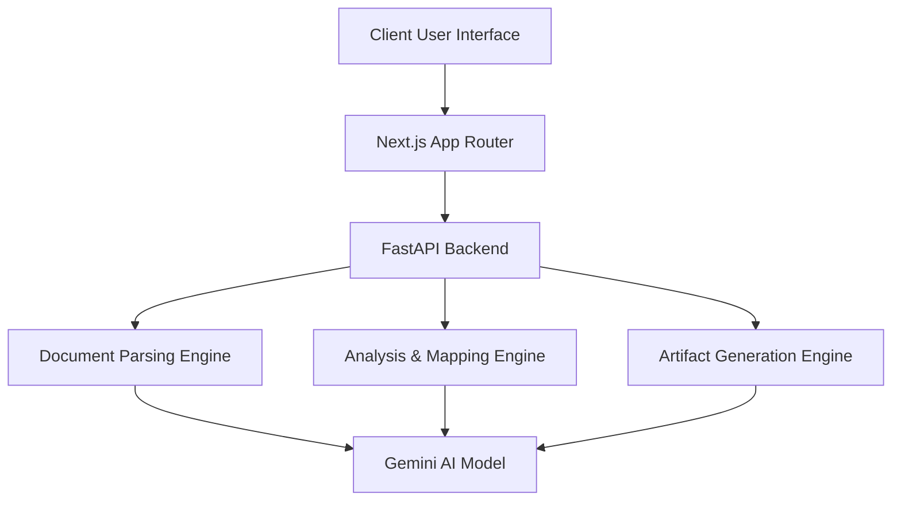

# Discovery Agent

## Overview

Discovery Agent is a comprehensive enterprise system designed to analyze uploaded technical documents, extract system inventories, identify missing integration gaps, and automatically generate production-ready code artifacts to bridge those gaps.

## Problem Statement

Enterprise systems are highly fragmented, and writing custom connectors to synchronize data between disjointed platforms is a manual, error-prone, and time-consuming process. The challenge was to build an intelligent platform spanning three levels of maturity:
- **Level 1 (System Discovery):** Parse unstructured documents and isolate distinct technical systems.
- **Level 2 (Analysis & Dashboarding):** Map business use cases to discovered systems, highlighting integration gaps and visualizing data flows.
- **Level 3 (Artifact Generation):** Automatically synthesize fully functioning, deployable connector code (Python scripts, tests, agent specifications) for the missing integrations.

## Features

### Level 1: System Discovery
- Intelligent PDF/Text parsing.
- Automated extraction of source and destination systems.
- Deep evidence tracking mapping every extracted claim back to the source text.

### Level 2: Use Case Mapping & Gap Analysis
- Interactive Use Case Builder.
- Automated mapping of theoretical use cases against actual discovered inventory.
- Comprehensive Results Dashboard featuring priority tables, system flow graphs, and data gap visualization.

### Level 3: Artifact Generation
- Single-click deployment-ready artifact synthesis.
- Live syntax-highlighted preview of generated code.
- Generates `connector.py` (with retry logic and pagination), `test_connector.py`, `agent.yaml`, `workflow.json`, and standard documentation.

## Architecture



## Tech Stack

**Frontend:**
- **Framework:** Next.js 16 (Turbopack)
- **Language:** TypeScript
- **Styling:** Tailwind CSS, Framer Motion
- **Data Viz:** Recharts, XYFlow

**Backend:**
- **Framework:** FastAPI
- **Language:** Python 3.11
- **Validation:** Pydantic

**AI Layer:**
- **Model:** Google Gemini
- **Strategy:** Structured schema extraction

## Screenshots
*(Add screenshots of the interface here)*

## Local Setup

### Backend
1. Create and activate a virtual environment:
```bash
python3 -m venv .venv
source .venv/bin/activate
```
2. Install requirements:
```bash
pip install -r backend/requirements.txt
```
3. Create a `.env` file with your Gemini API key:
```bash
GEMINI_API_KEY="your_api_key_here"
```
4. Start the server:
```bash
PYTHONPATH=. uvicorn backend.main:app --reload
```

### Frontend
1. Navigate to the frontend directory:
```bash
cd frontend
```
2. Install dependencies:
```bash
npm install
```
3. Start the development server:
```bash
npm run dev
```

## API Endpoints

- `POST /api/v1/documents/upload` - Parses an uploaded document.
- `GET /api/v1/inventory/{session_id}` - Retrieves the parsed system inventory.
- `POST /api/v1/analysis` - Submits defined use cases against the inventory.
- `POST /api/v1/generate-artifacts` - Generates a zip bundle of connector code for an integration gap.

## Demo Flow

1. **Upload:** Provide a system architecture document (PDF or text).
2. **Inventory:** Review the extracted systems and view context evidence.
3. **Analysis:** Define business use cases (e.g., "Sync Employee Data from Workday to Jira").
4. **Results:** View the analysis dashboard and identify critical integration gaps.
5. **Artifact Generation:** Click "Generate Artifacts" on a gap card to receive a complete, deployable Python integration connector.

## Future Improvements

- Support for more complex authentication patterns (OAuth 2.0 flows) in generated connectors.
- Integration with Terraform or Pulumi for infrastructure-as-code generation.
- Real-time connector testing against sandbox environments.

## Author
Saahir
